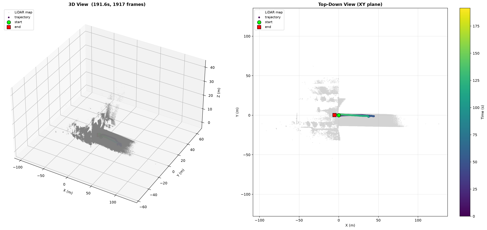

# UAV LiDAR Dataset

PX4 + 机载激光雷达无人机原始飞行记录（ROS1 bag），含 IMU、多源里程计与 3D 点云，用于状态估计、SLAM 与自主导航算法研究。



## 数据集结构

```
├── bags/
│   ├── underactuated-tunnel/     # 欠驱-隧道场景
│   └── fully-actuated-tunnel/    # 全驱-隧道场景
├── scripts/                       # 数据读取与可视化脚本
├── docs/preview/                  # 各场景预览图
└── README.md
```

## 硬件配置

| 组件 | 说明 |
|------|------|
| 飞控 | PX4 (MAVROS) |
| 激光雷达 | 机载固态 LiDAR（10Hz 点云输出） |
| IMU | 飞控内置（50Hz） + 激光雷达内置（200Hz） |
| 平台 | 四旋翼无人机 |

## 话题列表

| 话题 | 类型 | 频率 | 说明 |
|------|------|------|------|
| `/mavros/local_position/odom` | nav_msgs/Odometry | 30Hz | 融合里程计 |
| `/mavros/odometry/in` | nav_msgs/Odometry | 30Hz | 外部里程计输入 |
| `/ali_odom` | nav_msgs/Odometry | 10Hz | 激光/视觉里程计 |
| `/mavros/imu/data` | sensor_msgs/Imu | 50Hz | 融合 IMU |
| `/mavros/imu/data_raw` | sensor_msgs/Imu | 50Hz | 原始 IMU |
| `/livox/imu` | sensor_msgs/Imu | 200Hz | 激光雷达内置高频 IMU |
| `/ali_cloud` | sensor_msgs/PointCloud2 | 10Hz | 原始点云 |
| `/cloud_registered` | sensor_msgs/PointCloud2 | 10Hz | 配准后世界系点云 |
| `/mavros/vfr_hud` | mavros_msgs/VFR_HUD | 20Hz | 空速/油门/高度 |
| `/mavros/battery` | sensor_msgs/BatteryState | 0.5Hz | 电池状态 |

## Bag 文件列表

### 欠驱-隧道（underactuated-tunnel）

| 文件 | 时长 | 大小 | 场景 | 预览 |
|------|------|------|------|------|
| `2025-11-25-16-20-29.bag` | 191.6s | ~1.96GB | 室外飞行（含建图） | [preview](docs/preview/underactuated/preview_16-20-29.png) |
| `2025-11-25-16-26-22.bag` | 81.8s | ~924MB | 室外飞行（含建图） | [preview](docs/preview/underactuated/preview_16-26-22.png) |
| `2025-11-25-16-29-19.bag` | 7.0s | ~80MB | 隧道静态扫描 | [preview](docs/preview/underactuated/preview_16-29-19.png) |

### 全驱-隧道（fully-actuated-tunnel）

> 待添加

## 快速开始

### 环境依赖

```bash
pip install rosbags matplotlib numpy
```

### 查看话题信息

```bash
# 扫描指定场景目录下所有 .bag 文件
python scripts/inspect_bag.py bags/underactuated-tunnel/

# 或指定单个 bag
python scripts/inspect_bag.py bags/underactuated-tunnel/2025-11-25-16-20-29.bag
```

### 绘制点云建图 + 轨迹叠加图

```bash
# 指定 bag 和输出路径
python scripts/plot_map_trajectory.py bags/underactuated-tunnel/2025-11-25-16-26-22.bag output.png
```

> **注意：** bag 文件使用 Git LFS 管理，请先安装 [Git LFS](https://git-lfs.github.com/) 再 clone。